# Manual do Plugin Gestão de Demandas

> Versão de referência: **0.31.1** · Alvo: GLPI 11 e OpenProject 17.x.

## 1. Finalidade

O plugin conecta o ciclo de atendimento do GLPI à gestão técnica realizada no OpenProject. O chamado permanece como a referência de atendimento; a Work Package (WP) concentra a execução técnica. O plugin também disponibiliza recursos independentes de ponto, banco de horas e lançamentos de tempo em WPs.

Use este manual para configurar os perfis, operar os fluxos e validar o comportamento esperado. Informações técnicas de continuidade estão em [CODEX_HANDOFF.md](CODEX_HANDOFF.md).

## 2. Princípios de acesso e segurança

As permissões em **Administração > Perfis > Gestão de Demandas** são a única fonte de autorização do plugin. O nome do perfil — inclusive *Super-Admin*, *Master* ou *Cliente* — não concede funções automaticamente.

| Permissão | Permite |
|---|---|
| Visualizar a evolução pública da demanda | Consultar somente a fase pública e acompanhamentos públicos autorizados. |
| Visualizar dados técnicos do OpenProject | Ver IDs, links, status e demais dados técnicos de WPs. |
| Visualizar o histórico da integração | Consultar o histórico técnico de sincronizações. |
| Criar e vincular Work Packages | Criar WPs a partir de chamados autorizados. |
| Executar sincronização manual | Atualizar manualmente WPs já vinculadas. |
| Administrar as configurações do plugin | Alterar URLs, token do bot, mapeamentos, templates e regras administrativas. |
| Acessar / Exportar a visão gerencial | Consultar ou exportar a Visão Gerencial de Demandas. |
| Preparar contexto de chamado e WP para IA externa | Preparar um texto local para cópia consciente em uma IA externa. |
| Visualizar pendências operacionais da integração | Consultar a Central de Pendências de Integração. |
| Executar e tratar pendências operacionais da integração | Executar a verificação e reconhecer, ignorar temporariamente ou reabrir pendências. |
| Resolver conflitos de conciliação de Work Packages | Confirmar múltiplos vínculos com justificativa ou transferir, sob confirmação, um vínculo local seguro para correção. |

As permissões de monitoramento, alertas, IA e pendências exigem também **Visualizar dados técnicos do OpenProject**. O plugin repete as verificações no servidor; ocultar um menu não permite acesso direto por URL.

## 3. Instalação e atualização

1. Faça backup do banco e da pasta atual do plugin.
2. Copie a pasta `demandas` para `plugins/demandas` do GLPI.
3. No GLPI, acesse **Configuração > Plugins**.
4. Na primeira utilização, clique em **Instalar** e depois em **Ativar**.
5. Para atualizar, clique somente em **Atualizar**. **Não desinstale** o plugin: a desinstalação remove seus vínculos, configurações e históricos.
6. Após a atualização, revise os novos direitos em **Administração > Perfis > Gestão de Demandas**.

### 3.1 Monitoramento e aplicação controlada de releases

Em **Configuração do plugin > Integração e automação**, administradores podem habilitar a consulta diária da release oficial. A tela permite verificar manualmente e mostra a versão instalada, a release disponível e o link da release. A consulta aceita somente a API e os domínios oficiais do GitHub, com TLS validado, e **nunca** baixa ou instala arquivos pelo navegador do GLPI.

Para aplicar uma atualização, use uma janela de manutenção e um agente/terminal administrativo que possua acesso à pasta do GLPI. Pare o serviço web ou contêiner antes da troca e execute primeiro a validação sem alteração:

```powershell
./update-plugin-release.ps1 -PluginDirectory 'C:\caminho\para\glpi\plugins\demandas' -ValidatePackage
```

Depois de revisar a release e o backup planejado, execute com `-Apply`. O script baixa somente o ZIP da release oficial, confere a estrutura e a versão declarada, preserva a pasta anterior em `demandas-backup-<data>` e substitui somente a pasta do plugin. Em seguida, inicie o GLPI e clique em **Atualizar**. O script não acessa o banco, não guarda tokens e não exclui o backup. Mantenha a rotina sob controle da infraestrutura/configuração de servidores.

Em Linux, use PowerShell (`pwsh`) e informe em `-PluginDirectory` o caminho real de `plugins/demandas`. A verificação diária depende do cron externo nativo do GLPI; confirme esse agendamento com a infraestrutura. **Verificar agora** permite consultar manualmente mesmo sem o cron.

## 4. Configuração administrativa inicial

Esta etapa exige **Administrar as configurações do plugin**. Acesse a configuração do plugin e use a aba **Integração e automação**.

1. Informe a **URL interna da API do OpenProject**. Em Docker, ela normalmente termina em `/api/v3` e usa o hostname interno.
2. Informe a **URL externa para navegação** do OpenProject. Ela é usada nos links abertos pelo navegador.
3. Informe a **URL externa do GLPI**.
4. Defina o timeout de comunicação.
5. Informe o **token automático do bot**. Ele é exclusivo de webhook e sincronizações automáticas; não é usado para criar WPs.
6. Clique em **Salvar e testar conexão**.

Nunca registre token, senha ou URL privada em anexos, acompanhamentos ou repositórios. O token automático deve pertencer a um usuário técnico com o menor conjunto possível de permissões no OpenProject.

### 4.1 Fases, status e webhook

- Cadastre as fases públicas apresentadas ao solicitante.
- Em **De/Para de status**, associe cada status técnico do OpenProject a uma fase pública, mensagem padrão, envio automático e visibilidade do acompanhamento.
- Cadastre no OpenProject o webhook de **Work package atualizada**, usando a URL e o segredo apresentados pelo plugin. Restrinja o evento aos projetos necessários.
- Mantenha o segredo do webhook privado.

### 4.2 Classificação e templates

Na aba **Classificação**, determine de onde vem a classificação do chamado e os tipos de WP permitidos para cada valor. Uma classificação configurada sem regra correspondente bloqueia a criação de WP por segurança.

Na aba **Templates**, preencha o Markdown exigido para cada tipo de WP. O plugin bloqueia a criação se o tipo selecionado não possuir template configurado.

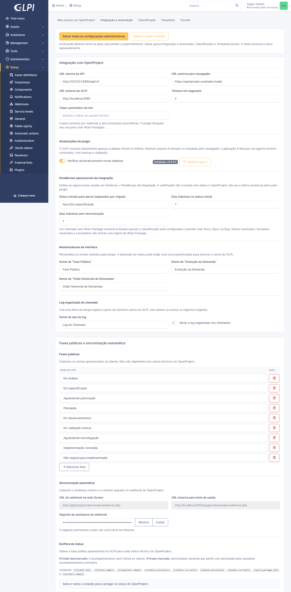

## 5. Token pessoal do OpenProject

Cada pessoa que cria WPs, sincroniza manualmente, monitora WPs ou lança tempo deve configurar o próprio token:

1. Abra **Minhas configurações > Meu acesso ao OpenProject**.
2. Informe o token pessoal da API.
3. Clique em **Salvar meu token** ou **Salvar e testar**.

O valor não é mostrado novamente. Deixá-lo vazio em uma edição mantém o token atual. O token pessoal não dá direito a uma função no GLPI: as permissões do perfil continuam obrigatórias.

## 6. Fluxo do chamado e Work Package

### 6.1 Criar uma WP

1. Abra o chamado e confirme que o perfil possui **Criar e vincular Work Packages**.
2. Na área técnica da demanda, escolha o projeto e o tipo de WP permitido.
3. Preencha os campos solicitados pelo OpenProject.
4. Carregue o template do tipo escolhido e complete a documentação no editor visual ou Markdown.
5. Se desejar relacionar a nova WP a uma anterior, selecione a WP, escolha o tipo de relação e marque a confirmação. A direção apresentada é da nova WP para a anterior.
6. Confirme a criação. Se a relação falhar depois de criar, repita na mesma tela para tentar apenas o relacionamento, sem criar outra WP.

O plugin registra o vínculo, a fase pública e o histórico técnico. Um chamado pode possuir mais de uma WP. Ao criar uma WP adicional, informe o motivo solicitado pelo formulário.

#### Documentar uma WP existente

Na grade de WPs vinculadas, clique em **Documentar**. A edição exige dados técnicos, criação/vinculação de WPs, leitura/alteração do chamado e token pessoal autorizado no OpenProject. O botão **Código** oferece seleção de linguagem e realce; cole imagens no editor ou use a ferramenta de imagens, ajustando as dimensões. Use **Adicionar anexos** para documentos. Salvar grava a descrição e associa os anexos no OpenProject.

Limites: 20 arquivos de até 15 MB por edição, documentação de até 500 KB e sessão de duas horas; limites menores da instância também se aplicam. Arquivos são enviados imediatamente, ainda sem contêiner, e associados ao salvar. O plugin não apaga anexos anteriores nem mantém cópias locais. Uma alteração simultânea exige recarregar e comparar: copie seu rascunho antes. Para macros/construções específicas do OpenProject, use Markdown. Veja [limitações e homologação](RELEASE_0.29.0.md).

### 6.2 Consultar e sincronizar

#### Incorporar WPs já registradas em Atividade DevOps

Na **Visão Gerencial de Demandas**, use **Conciliar Work Packages existentes** (também disponível na área técnica do chamado). O perfil precisa de **Visualizar dados técnicos do OpenProject** e **Criar e vincular Work Packages**, além de poder ler e alterar o chamado na entidade ativa.

1. Configure seu token pessoal e confira a URL externa do OpenProject na configuração do plugin.
2. Confira a prévia do campo **Atividade DevOps** do Fields. Ele deve conter a URL completa da WP na instância configurada.
3. Selecione até cinco referências por operação, marque a confirmação e clique em **Validar e conciliar selecionadas**.
4. Verifique o vínculo na **Evolução da Demanda** e a cobertura no painel. A conciliação não cria outra WP, não altera a WP externa e não publica fase ou acompanhamento. Depois, a sincronização normal e o webhook passam a reconhecer o vínculo.

Referências de outra instância e WPs sem acesso não são importadas. O mesmo par chamado–WP não é duplicado. A mesma WP pode ser conciliada a vários chamados, e um chamado pode receber várias WPs. O primeiro vínculo efetivo dispensa justificativa, mesmo quando há várias referências possíveis. Para vínculos adicionais do mesmo chamado ou WP, é necessária a permissão **Resolver conflitos de conciliação de Work Packages** e uma justificativa de 10 a 2.000 caracteres. Use **Selecionar possibilidades desta página** para conciliar juntas até cinco referências e, quando necessário, preencha a justificativa comum. A ordem da grade determina o primeiro vínculo do lote. O botão fica bloqueado durante o envio. Os vínculos anteriores são preservados, inclusive históricos, fases e entradas de tempo. A justificativa é registrada no histórico do novo vínculo. O campo original não é alterado. Solucionados e fechados podem ser incluídos escolhendo **Todos**. A cobertura contabiliza os vínculos confirmados, não apenas a presença de uma URL.

Quando houver conflito, clique em **Detalhes**. O modal informa se a mesma WP aparece em outros chamados, se já existe vínculo local e quais referências são visíveis para o perfil ativo. O número da WP abre a tarefa correspondente no OpenProject em nova aba. A transferência automática aparece somente para um conflito de vínculo local simples, quando o operador possui o novo direito, pode alterar ambos os chamados e o vínculo não possui entradas de tempo, fase pública nem acompanhamento público. Após a confirmação, ela move exclusivamente o registro local e cria eventos de auditoria nos dois chamados; a WP, o campo Fields e o OpenProject não são alterados. Para manter um compartilhamento correto, selecione a referência na listagem e informe a justificativa, em vez de transferir ou remover o vínculo anterior. Quem inicia a conciliação na Evolução da Demanda retorna à mesma aba do chamado de origem após confirmar. O webhook passa a processar todos os vínculos da WP, aplicando a regra de fase e acompanhamento de forma independente em cada chamado.

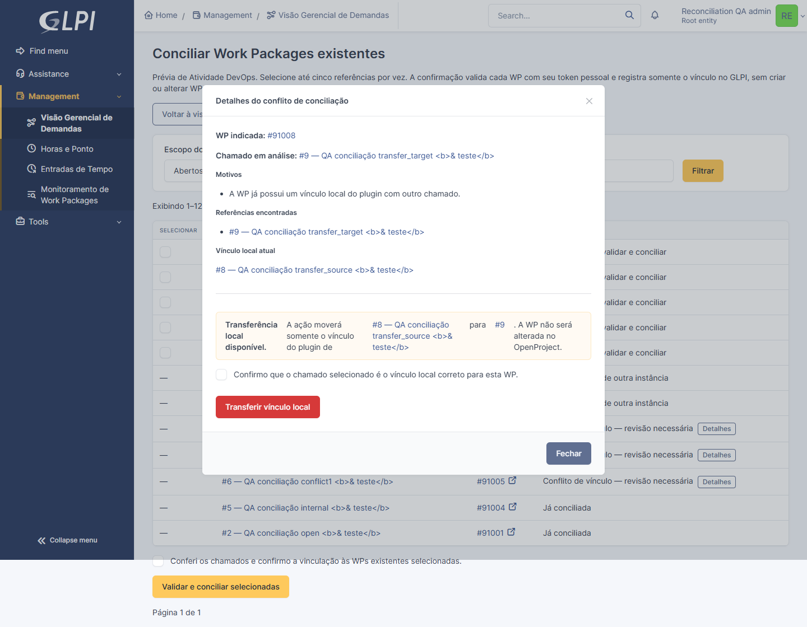

#### Acompanhamento dos vínculos

- Use **Sincronizar** no chamado quando possuir **Executar sincronização manual**.
- A sincronização atualiza os dados técnicos locais e pode atualizar a fase pública conforme o de/para configurado.
- O histórico técnico é visível somente a perfis autorizados.
- Clientes com somente visão pública não devem ver ID, link, status técnico ou responsáveis da WP.

#### Autor do vínculo e publicações SGE

A grade **Work Packages vinculadas** apresenta **Vinculado por**. O **Histórico da integração** e seu modal mostram **Usuário GLPI**. O plugin resolve nomes para conciliações antigas que guardavam o ID. Quando não há identidade registrada, informa **Não registrado**; eventos de webhook indicam automação.

1. Na aba **Evolução da Demanda**, clique em **TASKs e versões** na WP desejada.
2. O modal abre a última consulta salva. Para buscar dados atuais, clique em **Consultar agora**. É necessário token pessoal, **Visualizar dados técnicos do OpenProject**, **Executar sincronização manual** e permissão nativa de ler/alterar o chamado na entidade ativa.
3. Aguarde a descoberta e a consulta por etapas. São lidas subtarefas imediatas e relações diretas, incluindo tarefas concluídas, conforme o acesso do token. Outros tipos relacionados também aparecem com seu tipo explícito; descendentes de níveis adicionais não são percorridos.
4. Confira o número/link, título, tipo, relação, status e as publicações de cada tarefa. O texto **Incluída na build v1.112.0-beta.198 (Beta (homologação))**, por exemplo, identifica homologação; **v1.112.0 (Produção)** identifica produção. Referência a pull request sem esse comentário não é publicação. Ambiente não reconhecido fica explicitamente não informado.
5. A grade exibe as builds encontradas e a data da consulta. Reabra a aba para ver o evento correspondente no histórico, com autor e versões. Sincronizações posteriores preservam a data da consulta de publicações que utilizaram.

Uma publicação em uma TASK não confirma a entrega de todas as TASKs ou da WP inteira. **Nenhuma publicação identificada** significa que a consulta completa não encontrou o padrão nos comentários acessíveis; não comprova ausência de deploy. O plugin não consulta o GitHub privado e não confirma o estado real dos ambientes. A consulta é manual; use **Consultar agora** após novas publicações. Abrir a aba, sincronizar status ou receber webhook não refaz essa varredura.

Falhas de rede, autenticação, acesso, paginação ou expiração preservam o último resultado completo. A consulta aceita até 500 tarefas e 1.000 páginas por coleção, com prazo de 15 minutos. Se o acesso a uma tarefa falhar, revise o token e repita; não há gravação parcial. Somente versões, datas, identificadores de comentários e metadados das tarefas são salvos, sem o texto integral dos comentários. O recurso não modifica o OpenProject, fases públicas, acompanhamentos ou horas.

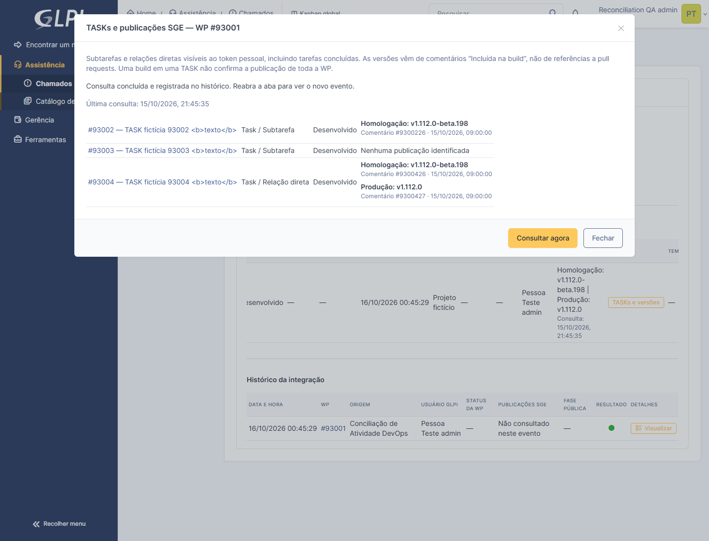

Captura obtida na base isolada pelo teste `tests/publications.cjs`.

Em telas pequenas, as informações das TASKs aparecem empilhadas, com rolagem apenas dentro do modal.

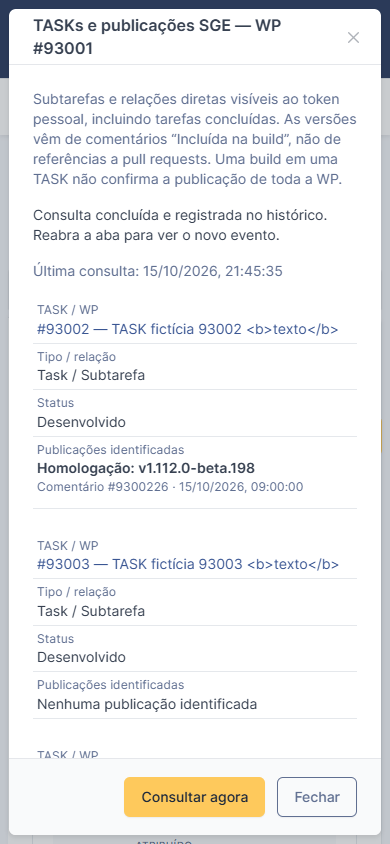

## 7. Monitoramento de Work Packages


Em **Gerência > Monitoramento de Work Packages > Minhas Work Packages**, o usuário autorizado pode consultar User Stories, Épicos e Bugs abertos dos quais é responsável no OpenProject.

1. Configure o token pessoal.
2. Clique em **Consultar minhas WPs** e aguarde o indicador de carregamento.
3. Use os cards de status para filtrar por situação.
4. Use os filtros por status, chamado GLPI, cliente do OpenProject e responsável.
5. Escolha 25, 50, 100 ou 200 itens por página conforme necessário.

Os links da WP e do chamado abrem em nova aba. A consulta é somente leitura e não cria nem altera WPs.

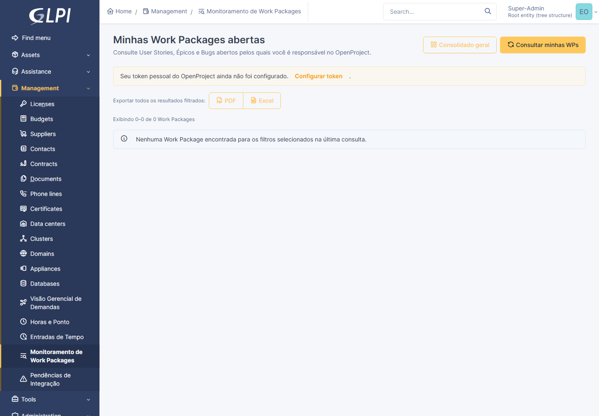

### 7.1 Alertas e consolidado

O sino no cabeçalho apresenta alertas pessoais gerados pelas consultas. A prévia é compacta; o histórico completo fica em **Gerência > Monitoramento de Work Packages > Alertas de Work Packages**.

O botão **Consolidado geral** aparece para quem também possui **Acessar a visão gerencial**. Ele reúne os snapshots das consultas realizadas por todos os usuários; não faz nova consulta ao OpenProject.

## 8. Preparar análise em IA externa

Na listagem pessoal de WPs, use **Preparar IA** quando possuir a permissão específica. O recurso permite selecionar quais dados serão incluídos no texto: WP, chamado, status, responsável, cliente, links, resumo, descrição, acompanhamentos públicos e anexos escolhidos.

O texto e a extração de anexos ocorrem localmente. PDF, documentos e imagens podem ter conteúdo extraído/OCR antes da cópia. Nada é enviado automaticamente a uma IA. Antes de colar o contexto no ChatGPT ou em outra ferramenta, confirme que você tem autorização para compartilhar todo o conteúdo selecionado, especialmente anexos e imagens.

## 9. Central de Pendências de Integração

Em **Gerência > Pendências de Integração**, o plugin confere dados locais já sincronizados. Para abrir a página, o perfil precisa de **Visualizar dados técnicos do OpenProject** e **Visualizar pendências operacionais da integração**.

### 9.1 Configurar regras

Em **Configuração do plugin > Integração e automação**, defina:

- os status iniciais separados por vírgula, por exemplo `Novo,Em especificação`;
- quantos dias uma WP pode permanecer em status inicial;
- quantos dias uma WP pode permanecer sem sincronização.

### 9.2 Executar e interpretar

O botão **Executar verificação** requer também a permissão **Executar e tratar pendências operacionais da integração**. A execução não chama e não altera o OpenProject.

As regras atuais são:

| Regra | Significado |
|---|---|
| Chamado elegível sem Work Package | Chamado GLPI aberto cuja classificação permite User Story, Épico ou Bug, mas não possui vínculo local. |
| Work Package parada no status inicial | WP ainda em um status inicial configurado acima do prazo. |
| Work Package sem sincronização recente | WP sem confirmação de sincronização dentro do prazo. |

Use os cards e filtros para priorizar a lista. Em cada ocorrência, é possível:

- **Reconhecer:** registra que alguém assumiu a conferência;
- **Ignorar por sete dias:** silencia temporariamente uma pendência conhecida;
- **Reabrir:** devolve a ocorrência à fila aberta.

Cada ação é auditada. A ocorrência é resolvida automaticamente na próxima verificação se a condição deixar de existir. A central não cria vínculo, não atualiza status e não envia acompanhamentos; a correção deve ser feita pelo usuário autorizado no GLPI ou OpenProject.

### 9.3 Captura validada pela suíte prática

A captura abaixo é atualizada somente pelo Playwright em uma base isolada com dados fictícios. Ela nunca deve ser gerada a partir de produção ou de uma cópia de produção.

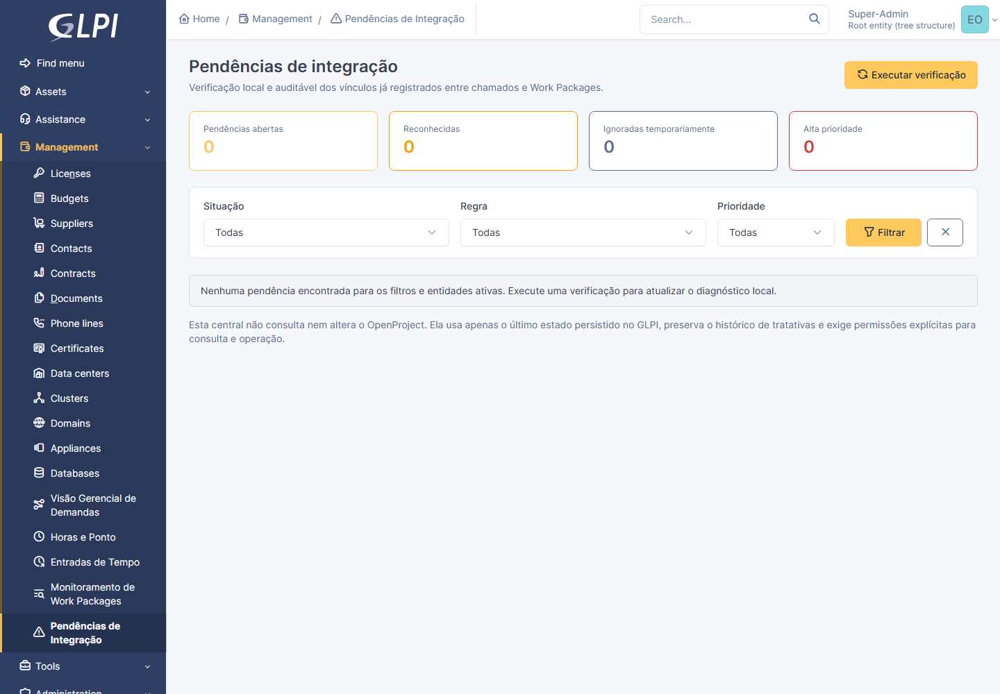

Veja [tests/e2e/README.md](../tests/e2e/README.md) para preparar o ambiente e gerar novamente a imagem antes de uma nova release.

## 10. Visão Gerencial de Demandas

Acesse **Gerência > Visão Gerencial de Demandas** com a permissão própria. O painel apresenta cobertura de WPs, demandas sem documentação, envelhecimento, sincronização e distribuições por classificação, cliente, status, fase, projeto e tipo.

A legenda de **Cobertura no OpenProject** aparece abaixo do gráfico. Em **Clientes com maior demanda**, os rótulos exibem o segundo nível da entidade (ex.: `PONTO ID > GOIÂNIA-GO` aparece como `GOIÂNIA-GO`). As contagens e o destino do filtro continuam correspondendo à entidade original; entidades sem segundo nível mantêm seu nome.

O escopo inicial é **Abertos**, excluindo chamados solucionados e fechados. Para consultar o histórico completo, abra **Filtros estratégicos**, selecione **Todos** em **Escopo dos chamados** e aplique os filtros. Cards, gráficos, grade e exportações PDF/Excel usam o mesmo escopo. A cobertura inclui os vínculos antigos após a conciliação descrita na seção 6.2.

- O painel de filtros é recolhido por padrão; expanda-o para combinar os critérios.
- Os indicadores levam ao detalhamento correspondente.
- Clique nos títulos das colunas para ordenar a grade mantendo os filtros aplicados.
- PDF e Excel exigem a permissão de exportação e preservam os filtros e a ordenação atual.

### 10.1 Aba Bugs e Melhorias

Após atualizar, conceda os direitos necessários em **Administração > Perfis > Gestão de Demandas**. Nenhum direito novo é habilitado automaticamente, nem para perfis administrativos. Saia e entre novamente após alterar o perfil.

| Recurso | Direitos necessários |
|---|---|
| Aba Bugs e Melhorias | Acessar a visão gerencial + Visualizar dados técnicos do OpenProject + Acessar a aba Bugs e Melhorias |
| Cards e filtro de conferência | Os anteriores + Conferir entregas com chamado aberto |
| Alerta no próprio chamado | Visualizar dados técnicos do OpenProject + Visualizar alerta de WPs no chamado + leitura nativa do chamado na entidade ativa |
| Salvar aba padrão pessoal | Acessar a visão gerencial + Definir minha visão gerencial padrão; a aba escolhida também precisa estar autorizada |
| PDF/Excel | Direitos de acesso à visão/conferência escolhida + Exportar a visão gerencial |

1. Abra **Gerência > Visão Gerencial de Demandas > Bugs e Melhorias**.
2. Os filtros começam recolhidos. Abra **Filtros estratégicos**, marque os **Status GLPI incluídos** e aplique os filtros. Por padrão são todos os status nativos não solucionados/fechados; desmarcar todos produz zero resultados. O rótulo operacional “Para desenvolvimento” não é convertido arbitrariamente em um status GLPI.
3. Combine cliente, classificação, datas, status WP e demais critérios. A classificação usa a mesma origem/regras do painel geral: bugs/erros técnicos e melhorias; sugestões, coletores e outras classificações ficam fora. Sem classificação válida, o chamado não entra nessa aba.
4. Comece por **Precisam de ação**. Os cartões mostram uma próxima ação, como **Atualizar dados**, **Vincular WP** ou **Conferir encerramento**. Clique para filtrar a grade. Indicadores zerados ficam em **Sem ocorrências**. **Por onde começar** destaca até dez chamados prioritários do filtro atual; cada linha resume os motivos e os status. Um chamado pode ter vários motivos, mas é contado uma vez por motivo: não some os cartões.
5. Use **Técnico atribuído no GLPI** e **Responsável OpenProject** para organizar a conferência. São papéis distintos; o atribuído da WP também aparece junto dela. Nome ausente no snapshot é apresentado como não informado, sem concluir que a WP esteja sem dono no OpenProject.
6. Em **Onde as demandas estão paradas**, compare as barras de quantidade de chamados por etapa e a coluna separada de maior tempo observado. Abra o histórico para ver os chamados mais antigos. Use **Mais indicadores** para cobertura, volume e distribuições. A grade conta cada chamado uma vez; clique em **Ver detalhes** na coluna **Work Packages** para consultar **todas** as WPs vinculadas, responsáveis e datas, mesmo se o filtro corresponder a apenas uma delas. Em telas estreitas, role as tabelas horizontalmente para acessar as demais colunas.

### Precisam de ação e envelhecimento observado

Os motivos incluem dados de integração desatualizados ou sem status, bloqueios/dúvidas, ausência de WP ou de responsável conhecido, permanência acima do prazo e, para perfis autorizados, entregas e divergências de encerramento. A ordem da fila prioriza qualidade dos dados, divergências e impedimentos; em seguida tempo observado e idade do chamado. Não é uma priorização de negócio automática.

O filtro **Atenção após (dias observados)** começa em 14 dias e aceita de 1 a 365. Ele vale para a consulta, não altera as configurações da Central de Pendências nem é salvo como preferência. O aviso de sincronização usa sete dias. Atualize dados pelo fluxo já existente antes de tomar decisões.

| Etapa | Status reconhecidos |
|---|---|
| Aguardando especificação | Novo, Em especificação |
| Prontos para desenvolvimento | A desenvolver, Planejado, A ser planejado |
| Em desenvolvimento | Em desenvolvimento, Em andamento, Retrabalho |
| Aguardando validação | Desenvolvido, Aguardando testes, Em testes, Testado, Pronto para entrega |
| Bloqueados ou em dúvida | Bloqueado, Em dúvida |
| Entregue | Entregue |
| Outras situações | Nomes não reconhecidos, mantidos sem conversão |

Esses grupos são operacionais e não alteram fases públicas. Cada chamado aberto conta uma vez em cada etapa em que possui WP. O maior tempo da etapa é o máximo observado entre as WPs, não uma soma. As cinco maiores permanências possuem link para conferência.

O tempo é calculado entre a primeira e a última observação local da sequência atual da etapa, usando eventos bem-sucedidos de sincronização/conciliação. Mudar entre status da mesma etapa preserva a sequência; sair e retornar a reinicia. Status personalizados distintos não compartilham um relógio. Comentários, última atualização da WP e builds não são tratados como transições.

**Histórico insuficiente** não significa zero dias. Uma única observação pode resultar em zero dias comprovados; sem histórico compatível não há duração. O tempo termina na última sincronização, mesmo se ela for antiga. Não é a data exata de entrada no OpenProject: mudanças ocorridas entre duas consultas podem não ter sido observadas. Essas limitações ficam explícitas na tela e nas exportações.

### 10.2 Conferir entregas com chamado aberto

Use os cards **Com alguma entrega**, **Todas as WPs em Entregue** e **Entrega parcial** para detalhar os chamados. Somente **Entregue** representa entrega concluída. Desenvolvido, Em testes e demais status não equivalem a entrega. Uma WP sem status conhecido não confirma conclusão; se outra estiver Entregue, o chamado fica em entrega parcial.

O link **Conferir solucionados/fechados com WPs não entregues** prepara o escopo histórico e os status correspondentes. Exige a mesma permissão de conferência. Para ajustar manualmente, selecione **Todos** no escopo e marque os status desejados. O plugin destaca divergências para avaliação; não reabre, soluciona nem fecha chamados.

Os indicadores mostram o escopo dos filtros; clicar em um indicador ou selecionar a conferência restringe a grade e a exportação. Por isso o total detalhado pode ser menor que o total do escopo. Os números por status de WP podem se sobrepor: um mesmo chamado pode ter WPs em diferentes situações.

Confira a última sincronização de cada WP e, se necessário, use o fluxo de sincronização existente antes de decidir. Sem data ou com mais de sete dias, aparece um aviso de desatualização. **Painel gerado** é o horário de montagem da página, não de atualização do OpenProject. Nenhuma página nova consulta a API, fecha chamados, altera WPs, fases públicas ou acompanhamentos. A decisão permanece com o analista.

Capturas da revisão 0.31.1 geradas pelo Playwright no GLPI 11.0.9 descartável, com dados fictícios. Os textos e controles novos foram verificados com contraste mínimo de 4,5:1 nos dois temas. As cores acompanham rótulos explícitos; não são a única indicação de situação.

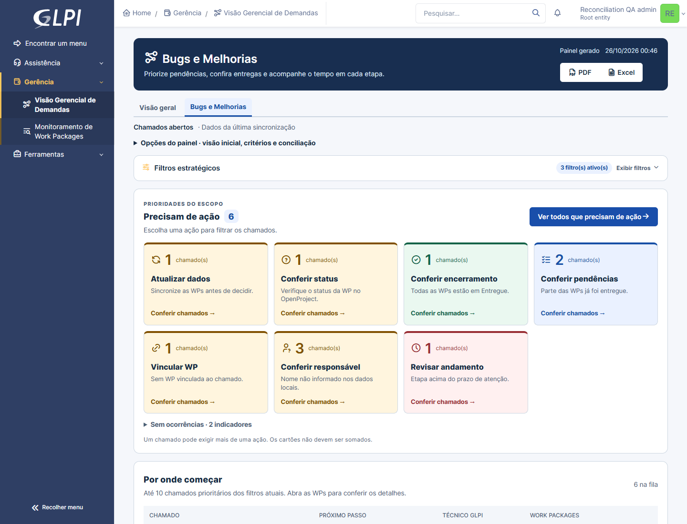

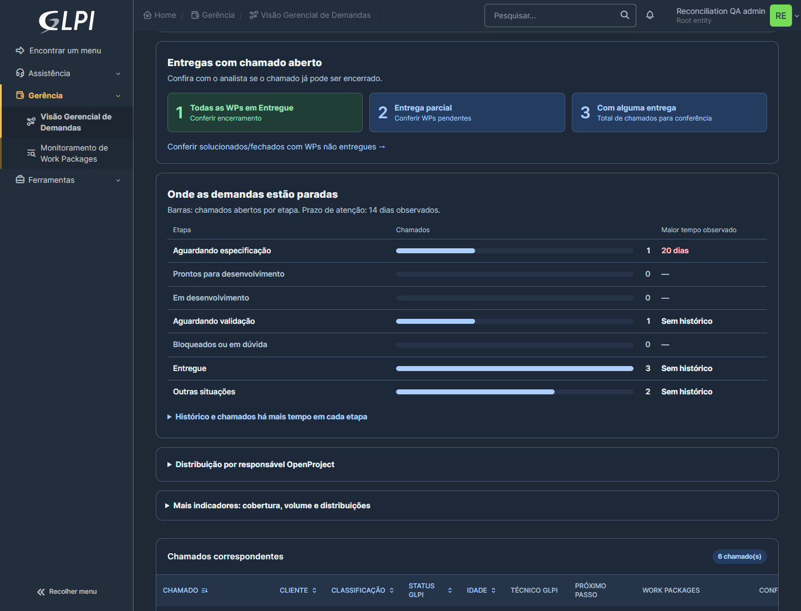

Veja também a [página completa](assets/manual/dashboard-bugs-1440-light.png) e a [visão em celular](assets/manual/dashboard-bugs-390-light.png). As capturas não representam validação de dados de produção.

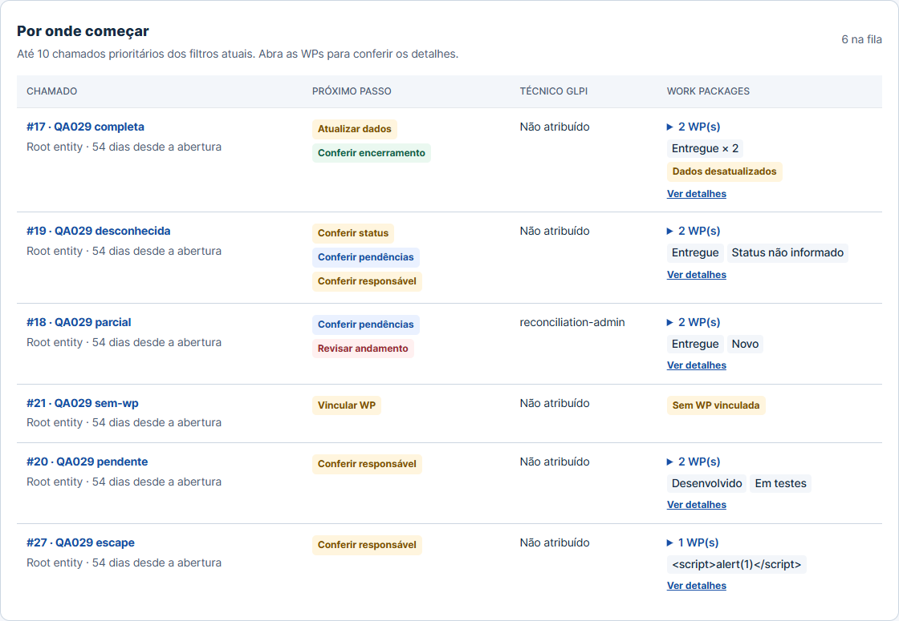

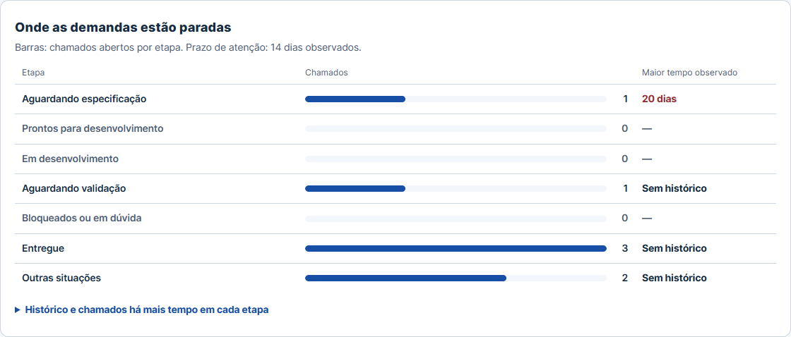

### 10.3 Alerta individual e visão padrão

No próprio chamado, o bloco **Status das WPs vinculadas** aparece na área de informações do atendimento para perfis autorizados, mostrando IDs com links, status e sincronização. Chamados sem vínculo não exibem o bloco. Perfis de clientes sem os direitos técnicos não recebem esse conteúdo.

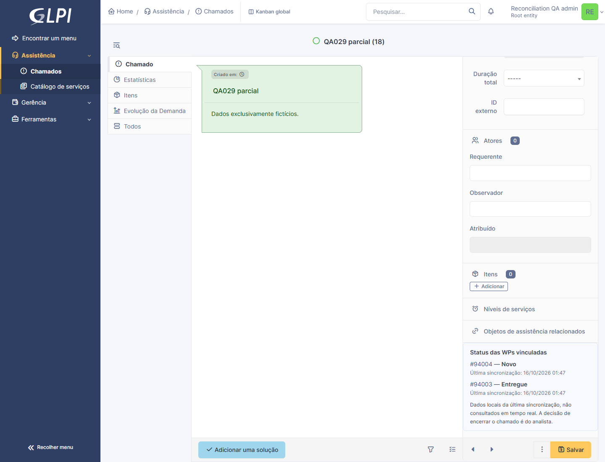

Na aba Bugs e Melhorias, abra **Opções do painel > Preferência de visão inicial**, selecione **Minha visão padrão** e clique em **Salvar visão padrão**. Na Visão geral, o formulário continua no topo. A escolha vale apenas para seu usuário e só define qual aba abrir quando não houver uma aba explícita na URL. Links de drill-down continuam abrindo a aba indicada. A preferência não é compartilhada com outros usuários e não guarda os filtros. Se mudar para um perfil sem acesso à aba escolhida, o painel abre a visão geral; sem acesso gerencial, o acesso é negado. As opções também contêm os critérios dos indicadores e o acesso à conciliação para perfis autorizados.

Capturas do manual são geradas com dados sintéticos por `tests/dashboard-bugs.cjs`, incluindo desktop, celular e temas claro/escuro. Não gere capturas com dados de produção.

## 11. Horas, ponto e ausências

Os recursos de ponto são independentes das entradas de tempo enviadas ao OpenProject.

### 11.1 Registro de ponto

Em **Gerência > Horas e Ponto**, registre as marcações do dia. O calendário considera a semana de domingo a sábado, identifica intervalo de almoço e destaca o dia atual. Dias sem marcação e sem ausência são neutros: não geram débito no banco de horas.

Use o modal do dia para lançar múltiplas marcações. Os tipos são sugeridos na ordem: Entrada manhã, Saída manhã, Entrada tarde e Saída tarde.

### 11.2 Ausências e banco de horas

- Registre ausência integral ou parcial, justificada ou não.
- Ausência justificada é neutra no banco de horas e pode conter comprovantes.
- Ausência não justificada gera o débito correspondente.
- Em **Minhas ausências**, consulte e filtre seus registros; anexos autorizados podem ser baixados.
- Em **Auditoria do Banco de Horas**, confira saldo histórico, créditos, débitos e faltas justificadas neutras.
- O saldo histórico é opcional e deve reproduzir o valor de outro sistema na data-base informada.

### 11.3 Feriados e dias não úteis

Perfis com **Administrar feriados e compensações** configuram os dias sem expediente. Feriados, compensações e dias não úteis cadastrados não incidem no banco de horas.

## 12. Entradas de tempo em Work Packages

Em **Gerência > Entradas de Tempo**, clique em **Nova entrada**, ao lado de **Sincronizar selecionadas**, e escolha a origem:

- **Relacionada ao GLPI**: selecione uma WP vinculada a um chamado que você possa ler.
- **Outra WP do OpenProject**: pesquise pelo ID ou por pelo menos três caracteres do título, usando seu token pessoal. Selecione um dos resultados acessíveis (até 20 por pesquisa). Essa operação não cria vínculo nem exige um chamado GLPI.

Informe data, atividade, início, fim e comentário quando aplicável. As atividades vêm do formulário da WP no OpenProject. Salve primeiro no GLPI e sincronize quando a entrada estiver completa. Edições e exclusões de uma entrada já sincronizada também são enviadas ao OpenProject com seu token pessoal.

A grade mostra o **Chamado GLPI** quando houver vínculo; o número abre o chamado em nova aba somente quando você possui leitura nativa dele. Para entradas sem chamado, a coluna mostra um traço. O ID sincronizado abre o relatório de **Tempo e Custos** da WP quando seu projeto puder ser identificado. Essas entradas são independentes do ponto.

O token deve pertencer ao mesmo OpenProject configurado na integração. No Docker local, use API interna `http://openproject/api/v3` e navegação `http://localhost:8280`; não use HTTPS no serviço interno sem TLS nem misture token local e URL de produção.

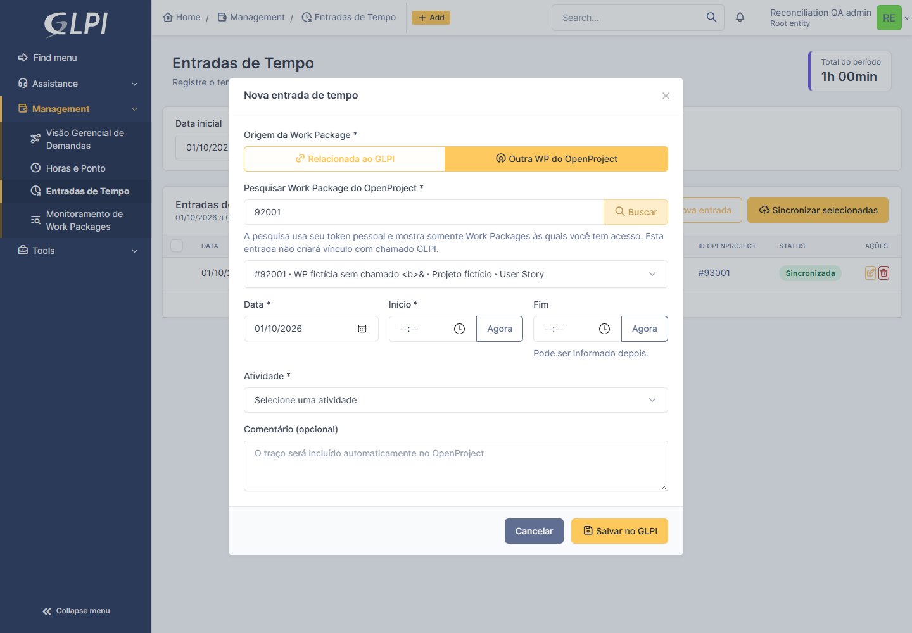

Somente entradas de tempo são sincronizadas com o OpenProject. Marcações de ponto nunca são enviadas como tempo de WP.

## 13. Checklist de operação

### Backlog

Em **Gerência > Backlog**, pesquise por número da WP, título, cliente, projeto, responsável ou chamado. A busca considera os status selecionados em **Escolher colunas**; cada coluna possui sua própria rolagem. Os cards ficam disponíveis antes das horas, que são preenchidas progressivamente.

Os links de chamados conciliados abrem em nova aba e respeitam as entidades e permissões de leitura do GLPI. Clique no card para ver a descrição formatada e as imagens dos anexos. Referências ainda existentes apenas no Fields precisam ser conciliadas.

Para consultar colegas, o perfil deve possuir **Consultar Backlog de colegas com o próprio token**, além dos direitos de Backlog e dados técnicos. Clique **Consultar colegas** e escolha o responsável. Seu token limita as WPs visíveis, suas colunas permanecem iguais e o relógio continua somando suas próprias horas. Nenhuma preferência do colega é alterada.

- configuração automática testada e webhook assinado;
- mapeamento de status e mensagens públicas revisados;
- classificação e templates preenchidos;
- tokens pessoais registrados somente pelos operadores necessários;
- perfis de cliente limitados à visão pública;
- permissões técnicas, de monitoramento, IA e pendências concedidas somente a perfis internos responsáveis;
- prazos da Central de Pendências revisados;
- feriados e dias não úteis configurados antes da conferência do banco de horas.

## 14. Solução de problemas

| Sintoma | Verificação inicial |
|---|---|
| Menu ou botão não aparece | Confira o perfil ativo e cada permissão exigida; saia e entre novamente se o GLPI mantiver o menu em cache. |
| Consulta de WPs não retorna dados | Confirme o token pessoal, as permissões no OpenProject e se o usuário é responsável pelas WPs abertas. |
| Erro ao sincronizar | Confirme o token pessoal, URL interna, acesso da WP e histórico técnico do chamado. |
| Cliente vê dados de WP | Revogue imediatamente **Visualizar dados técnicos do OpenProject** e revise o perfil ativo; visão pública não deve conceder esse direito. |
| Pendência não aparece | Execute uma nova verificação, confira entidades ativas, leitura do chamado, classificação e prazos configurados. |
| Pendência não desaparece | Corrija a condição no sistema de origem e execute a verificação novamente. |

Não registre senhas, tokens, conteúdo integral de chamados ou anexos sensíveis em solicitações de suporte. Para dados técnicos e histórico de versões, consulte a documentação de release em `docs/`.
